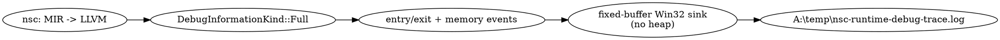

# Tanda correctiva NSC 3.0.5: traza Debug del programa generado

Fecha: 2026-10-16
Rama: `development`
Revisión correcta conocida para iniciar esta unidad: `82ab25f3336523935be9b415b4cb113baeaed02d`

## SCOPE LOCK

### Objetivo exacto autorizado

Instrumentar los ejecutables NativeSharp generados en modo Debug para obtener una traza persistente,
buscable y resistente al cierre anormal que identifique la clase, la función y el tipo de callable que
se estaba ejecutando, además de las operaciones de memoria/lifetime directamente representadas en MIR.
La finalidad inmediata es localizar la primera operación causal anterior al fallo externo
`0xC0000374 (STATUS_HEAP_CORRUPTION)` observado al ejecutar `al82dev`.

### Naturaleza del cambio

Infraestructura diagnóstica temporal y correctiva. No es una feature del lenguaje ni una modificación
del contrato de usuario.

### Entrada exacta y fallo observado

- Productor: `nsc.exe` de `development` construyendo el proyecto externo en `O0`.
- Resultado del productor: PASS externo en 115.3 s; el ejecutable fue generado.
- Consumidor: el ejecutable generado.
- Fallo: terminación aproximadamente 1.9 s después de iniciar con código `3221226356` / `0xC0000374`.
- Invariante violado: una operación de heap detectó corrupción de sus estructuras internas.
- Operación exacta responsable: todavía no demostrada; esta tanda produce la evidencia que falta.

### Evidencia externa posterior recibida durante la tanda

La instrumentación manual del consumidor aisló el último checkpoint en
`010 program.before-game-constructor`; no alcanzó `100 constructor.enter` y esa ejecución terminó con
`0xC0000005 (STATUS_ACCESS_VIOLATION)`. Esto acota el intervalo a la asignación del objeto, la invocación
del constructor o el constructor base anterior al cuerpo instrumentado, pero no demuestra por sí solo un
defecto de metadata ni una incompatibilidad entre generaciones de librerías. Las fechas distintas de los
artefactos son correlación, no causa. No se modifica NSMETA ni se ordena recompilar bindings en esta tanda.

### Hipótesis causal de esta unidad

La información actual no permite distinguir entre escritura fuera de límites, doble liberación,
liberación mediante un allocator incorrecto o corrupción previa detectada tardíamente. Una traza del
proceso compilador no puede resolverlo porque `nsc.exe` ya terminó correctamente cuando ocurre el fallo.
La unidad causal autorizada es, por tanto, instrumentar el programa generado sin cambiar su semántica.

### Presupuesto de cambio

| Dimensión | Autorizado |
|---|---|
| Repositorio | Exclusivamente `A:\nsc-devel` |
| Componente | Lowering MIR a LLVM del programa generado |
| Archivo funcional inicial | `src/LLVM/ProjectOopLlvmLowerer.cpp` |
| Símbolos | `OopLlvmImplementation`, definición de funciones MIR y puntos MIR de allocation/deallocation |
| Perfil | Sólo `DebugInformationKind::Full` |
| Salida | `A:\temp\nsc-runtime-debug-trace.log` |
| Pruebas | Build dirigido de `nsc`; fixture O0+Debug focal; inspección de IR/ejecución dirigida |

Si la prueba demuestra que el helper necesita una importación Win32 que no está en la tabla compartida,
se ampliará este mismo documento antes de tocar esa tabla. No se autoriza modificar consumidores externos.

### Comportamiento protegido

- Release, `-g0` y line-tables-only no contienen la instrumentación ni pagan su costo.
- Sintaxis, semántica, ABI, NSMETA, mangling, ownership, allocator provenance y layout permanecen idénticos.
- O0, O1, O2 y O3 conservan su significado; `-O0` no se usa como sinónimo de Debug.
- No se reactivan versiones de NSMETA ni rechazo por versión.
- No se modifica ningún juego, binding, librería ni instalación externa.
- La instrumentación de genéricos preservada bajo `INSTRUMENTATION CODE` sigue desactivada.

### Archivos y subsistemas protegidos

- Parser, lexer, sema, generics, HIR, MIR builder, metadata/NSMETA, linker y runtime público.
- `A:\native-sharp-3.0-baseline`, `C:\native-sharp`, juegos, bindings y otros repositorios.
- Pruebas, manifiestos y expectativas existentes no se adaptan para ocultar un fallo.

### Acciones prohibidas

- Baseline, batería completa, deploy, instalación, push, pull o fetch.
- Escribir fuera de `A:`.
- Usar MSYS/MSYS2/MinGW/Cygwin o rutas absolutas de toolchain.
- Emitir la traza por consola.
- Reservar memoria dinámica dentro del sink de traza generado.
- Corregir el heap por tanteo antes de identificar la primera operación causal.
- Instrumentar LLVM u otro repositorio porque un nombre aparezca en una pila sin demostrar su propiedad.

### Diseño fijado

La instrumentación tiene dos compuertas:

1. **Compuerta de generación:** sólo `DebugInformationKind::Full` emite helpers, strings y llamadas.
2. **Flag/filtro global del módulo Debug:** una máscara permite habilitar funciones y memoria. Se
   inicializa activa durante el diagnóstico y puede quedar en cero al aparcar el código.

El lowerer genera automáticamente eventos para todas las funciones MIR; no se editan manualmente cientos
de clases. Cada registro incluye una etiqueta estable independiente del defecto, evento, clase/tipo,
callable y clase de callable. El sink usa strings estáticos, `CreateFileA`, `WriteFile` y `CloseHandle`;
no usa el heap que está bajo investigación. Esas APIs pertenecen exclusivamente al módulo separado
`NativeSharp.Runtime.Win32`; el módulo del usuario sólo referencia el hook interno
`__nativesharp_file_append_all_text`. La ruta se abre en append por evento para que el prefijo ya escrito
sobreviva a una terminación anormal.



La fuente DOT queda embebida para reproducibilidad. `dot` no está disponible en el PATH nativo al iniciar
esta tanda, por lo que no se genera una figura SVG y no se instala ni sustituye Graphviz silenciosamente.

### Criterio exacto de terminación de la instrumentación

- El build focal de `nsc` termina con código cero.
- Un ejecutable `-g` emite registros de entrada/salida con clase y función al archivo de `A:\temp`.
- Un artefacto `-g0` no contiene el helper, la ruta ni las llamadas.
- El sink no realiza asignaciones de heap.
- La traza queda etiquetada como `INSTRUMENTATION CODE` para localizarla y aparcarla después del defecto.
- Se crea un commit local aislado con código, prueba focal y esta evidencia.

Este criterio termina la unidad diagnóstica, no la tarea persistente. El defecto `0xC0000374` sólo se
considerará corregido después de identificar su primera causa, aplicar una corrección independiente,
recompilar y ejecutar de nuevo el consumidor afectado.

## Implementación realizada

La instrumentación reside únicamente en `ProjectOopLlvmLowerer.cpp` y queda marcada mediante comentarios,
símbolos y registros que contienen `INSTRUMENTATION CODE`.

- `__nsc_runtime_debug_trace` filtra la categoría y entrega path/registro como strings estáticos al hook
  interno `__nativesharp_file_append_all_text`, que abre el archivo fijo en modo append, escribe y cierra.
- `__nsc_runtime_debug_trace_flags` es una máscara privada por módulo: bit 0 para callables y bit 1 para
  memoria. Su valor diagnóstico inicial es `3`.
- Cada función MIR genera `ENTER` al comenzar su bloque de entrada.
- `EXIT` se genera después de los cleanups y de liberar capture cells, inmediatamente antes del retorno
  real. No se etiqueta como salida un `yield`, una suspensión ni una expresión divergente.
- Las rutas del allocator y deallocator estándar quedan envueltas con `ALLOCATE` y `FREE-BEGIN`.
- El sink no reserva memoria del heap: usa strings NativeSharp globales estáticos; el hook del runtime usa
  almacenamiento de pila para terminar la ruta y recibir el resultado de `WriteFile`.
- El módulo del usuario no recibe declaraciones de `CreateFileA`, `WriteFile` ni `CloseHandle` por causa de
  esta instrumentación. Esto preserva exactamente cualquier firma de import declarada por sus bindings.

La traza del juego que el usuario está agregando manualmente es evidencia complementaria y debe conservar
otro archivo o etiqueta. No sustituye ni se mezcla con el prefijo automático
`[NSC RUNTIME DEBUG INSTRUMENTATION CODE]`.

## Evidencia dirigida

Revisión base examinada: `82ab25f3336523935be9b415b4cb113baeaed02d`.

1. `cmake --build build-clang --target nsc --parallel 16`: PASS.
   - Build hash resultante: `e71666a4e3dde2e2`.
   - Contrato de host runtime estático: PASS.
2. Emisión focal del fixture `tests/performance/p305/generics-32/generics-32.nsproj` con
   `-O0 --profile=debug`: PASS.
   - Objeto: `A:\temp\nsc-generics-32-debug-trace.obj`.
   - Máquina: `0x8664`; 12 secciones; debug information `full`.
   - La inspección de strings encontró `ENTER` y `EXIT` para `Program.Main` y `Program` constructor,
     además de `ALLOCATE` y `FREE-BEGIN`.
3. Emisión del mismo fixture con `-O0 -g0`: PASS.
   - Objeto: `A:\temp\nsc-generics-32-no-trace.obj`.
   - Máquina: `0x8664`; 7 secciones; debug information `none`.
   - Coincidencias de etiqueta, ruta y símbolos `__nsc_runtime_debug_*`: cero.
4. Prueba contrafactual de imports mediante un proyecto temporal fuera del repositorio: PASS para
   llamadas reales a `CloseHandle(long)` y `CloseHandle(void*)`. Ambos objetos Full Debug pasaron el
   verificador LLVM y la verificación COFF.

## Corrección causal posterior: colisión de firma CloseHandle

Una compilación externa Full Debug demostró que el diseño inicial de imports compartidos era incorrecto:

```text
Call parameter type does not match function signature
call i32 @CloseHandle(i64 ...)
```

La instrumentación había insertado `CloseHandle(ptr)` en `functions_`. Cuando el binding del consumidor
declaró `CloseHandle(long)`, `declareFunctions` reutilizó por nombre la entrada anterior y descartó su firma
física `i64`; el verificador rechazó después la llamada. La causa fue exclusivamente la instrumentación, no
el juego, la biblioteca ni NSMETA.

La corrección elimina del módulo usuario los tres imports Win32 del sink y delega la escritura al hook interno
del runtime. Evidencia dirigida con build hash `090a5a160deff166`:

- `nsc` focal: PASS; contrato de host runtime estático: PASS.
- Repro Full Debug que invoca `CloseHandle(long)`: PASS hasta COFF.
- Repro Full Debug que invoca `CloseHandle(void*)`: PASS hasta COFF.
- El objeto contiene su propio `CloseHandle` y `__nativesharp_file_append_all_text`; no contiene
  `CreateFileA` ni `WriteFile` introducidos por la instrumentación.
- Control `-O0 -g0`: cero coincidencias de etiqueta, ruta o símbolos de instrumentación.

## Segunda evidencia externa: frontera dentro de la construcción

Las tres trazas recibidas el 2026-10-16 corrigen y estrechan la hipótesis anterior:

- `nsc-method-bodies-trace.log` termina correctamente: 443 `CALLABLE-BEGIN`, 443 `CALLABLE-END`,
  tres ondas completas, inicializadores de campos, post-análisis, resúmenes de escape y `BUILD-END`.
  Por tanto, esa compilación del juego no cayó en `method-bodies`; esta traza no corresponde al
  desbordamiento de pila observado al intentar reconstruir otra biblioteca.
- `nsc-runtime-debug-trace.log` conserva una pila perfectamente anidada al terminar:
  `Program.Main` -> `Al82Dev.MyGame.MyGame()` -> `Al82Dev.MyGame.MyGame(bool)`.
- Dentro de esa pila terminan por completo los constructores y los métodos `Initialize`,
  `ClearBucketSlots` y `ClearHashCodeSlots` de dos campos `Dictionary`: uno
  `Dictionary<string,string>` y otro `Dictionary<string,byte>`.
- No aparece ningún `FREE-BEGIN`.
- `al82dev-startup-checkpoint.log` conserva solamente
  `010 program.before-game-constructor`; no alcanza el primer checkpoint explícito del cuerpo,
  `100 constructor.enter`.

Esto descarta como causa inmediata la reserva bruta del objeto y demuestra que el código generado sí
entra a ambos constructores de `MyGame`. La atribución previa a un constructor base precompilado o a
NSMETA no queda demostrada. La frontera causal pendiente es la inicialización implícita de campos, la
escritura posterior al segundo inicializador o la transición a la primera sentencia explícita.

### Ampliación autorizada del SCOPE LOCK

Se añade una tercera categoría a la máscara privada del módulo Debug: bit 2 para escrituras de campo.
Cada nodo MIR `Store` cuyo destino directo sea `FieldAddress`, `BitFieldAddress` o
`StaticFieldAddress` emite:

1. `FIELD-STORE-BEGIN` antes de evaluar la dirección y el valor;
2. `FIELD-STORE-END` después de completar la escritura y cualquier reemplazo/destrucción exigida.

Cada registro identifica almacenamiento, clase, campo, ordinal de miembro, desplazamiento, tipo y
callable activo. No se agrega información a NSMETA, no se modifica layout, no se inspecciona ni edita el
consumidor y no se cambia la semántica de los stores. El propósito de la siguiente ejecución externa es
distinguir exactamente entre fallo durante el inicializador, durante la escritura o después del campo.

### Evidencia focal de la ampliación

- `cmake --build build-clang --target nsc --parallel 16`: PASS.
- Build hash del compilador: `3344bc918a51b8c5`.
- Fixture existente `tests/bug_triage/b5_ctor_owned_field_array`, emisión O0 Full Debug a objeto: PASS
  incluido el verificador LLVM.
- El objeto Full Debug contiene `FIELD-STORE-BEGIN`, `FIELD-STORE-END`, `field=items` y la etiqueta
  estable `NSC RUNTIME DEBUG INSTRUMENTATION CODE`.
- La misma fixture emitida con `-O0 -g0`: PASS incluido el verificador LLVM; cero coincidencias de
  cualquiera de esas cadenas de instrumentación.
- Los objetos focales quedaron fuera del repositorio, bajo `A:\temp`.

## Tercera evidencia externa: fallo dentro de `ClearHashCodeSlots`

La ejecución posterior con las marcas de campos conserva una traza nueva y no acumulada. Su último
evento es `ENTER` de
`Dictionary<string,string>.ClearHashCodeSlots`; no existe el `EXIT` correspondiente. Antes de ese punto:

- Los stores de `hasher`, `buckets`, `entryHashCodes`, `entryNext`, `entryKeys`, `entryValues`, `count`,
  `freeFirst` y `freeCount` tienen parejas completas `FIELD-STORE-BEGIN/END`.
- Las cinco reservas de arreglos terminan y se publican en sus campos.
- `ClearBucketSlots`, que ejecuta el mismo patrón de bucle y store sobre `buckets`, entra y sale.
- El fallo aparece al comenzar el patrón equivalente sobre `entryHashCodes`.
- El checkpoint manual continúa en `010 program.before-game-constructor`; no hay `FREE-BEGIN`.

La nueva evidencia descarta una caída posterior al segundo diccionario: la ejecución actual no termina
siquiera el primer `Dictionary<string,string>`. Debido a que `ClearBucketSlots` puede haber escrito fuera
de su bloque y el daño manifestarse al tocar `entryHashCodes`, el último nombre de función no basta para
distinguir causa de detección.

### Segunda ampliación autorizada del SCOPE LOCK

Dentro del mismo bit 2 de instrumentación Debug se añaden fronteras para:

- `FIELD-LOAD-BEGIN/END` con nombre y offset del campo;
- `ARRAY-LENGTH-BEGIN/END`;
- `ARRAY-ELEMENT-BEGIN/END` alrededor de receptor, índice, bounds check y dirección/load;
- `ARRAY-STORE-BEGIN/END` alrededor de la escritura efectiva.

La repetición de estos registros permite contar las iteraciones de `ClearBucketSlots` y determinar si
el primer acceso a `entryHashCodes` falla al cargar el campo, leer `Length`, calcular la dirección o
escribir el elemento. Continúan siendo strings estáticos emitidos sólo en Full Debug; no se modifica
layout, ABI, NSMETA, el código fuente de la biblioteca ni el consumidor.

### Evidencia focal de la segunda ampliación

- `cmake --build build-clang --target nsc --parallel 16`: PASS; contrato de host runtime estático:
  PASS; build hash `fd084ae10bee61aa`.
- Fixture existente `tests/bug_triage/b5_ctor_owned_field_array`, emisión O0 Full Debug a objeto:
  PASS incluido el verificador LLVM.
- El objeto Full Debug contiene las ocho fronteras nuevas: begin/end de field load, array length,
  array element y array store.
- La misma fixture emitida con `-O0 -g0`: PASS incluido el verificador LLVM; cero coincidencias para
  las ocho fronteras.
- Ambos objetos quedaron fuera del repositorio en `A:\temp`.

## Validación pendiente y bloqueo de esta máquina

No se afirma todavía que el archivo físico haya sido escrito por un ejecutable. La construcción focal de un
`.exe` recorrió todas las fases de NSC y la emisión de objeto, pero el paso de enlace quedó bloqueado porque
`nslink.exe` no está disponible en el PATH nativo de esta máquina. Conforme a los lineamientos, no se buscó
en rutas absolutas, no se alteró PATH y no se sustituyó la herramienta.

La validación externa debe usar el compilador reconstruido y compilar el juego con información Debug completa:

```text
--profile=debug
```

o, de forma equivalente para esta compuerta:

```text
-g
```

`-O0` por sí solo no activa la instrumentación. Después de ejecutar el juego desde su GUI, la traza automática
debe quedar en `A:\temp\nsc-runtime-debug-trace.log`. La ausencia de ese archivo sólo es diagnóstica si el
comando de compilación confirma `profile-debug-information: full` o `debug-information: full`.
