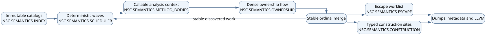

# SEM-00.01: fundamento de aseguramiento para rendimiento semantico

**Componente:** NativeSharp Compiler 3.0

**Alcance:** `method-bodies` y `construction`

**Configuracion de validacion:** Windows x64, O0

**Tag primario:** `NSC.SEMANTICS.PERFORMANCE`

## 1. Objetivo

Este documento establece la trazabilidad, instrumentacion, analisis estatico y arquitectura que gobiernan las seis
tandas de reingenieria semantica. No modifica la semantica del lenguaje ni autoriza un baseline. Su funcion es hacer
que cada optimizacion posterior tenga una causa medida, un contrato observable y evidencia reproducible.

## 2. Trazabilidad

| Requisito | Implementacion objetivo | Evidencia de cierre |
|---|---|---|
| `SEM-PERF-001` | Indices laterales O(1) sin alterar vectores ordenados | Pruebas de colision y ultimo binding |
| `SEM-PERF-002` | `construction` consume sitios tipados | Prueba que no redescubre cuerpos |
| `SEM-PERF-003` | Ownership usa estado denso por callable | Pruebas de branch, loop, move y borrow |
| `SEM-PERF-004` | Escape usa grafo inverso y worklist | Pruebas de ciclos, monotonia y orden |
| `SEM-PERF-005` | Analisis mutable aislado por callable | Fusion invertida produce igual salida |
| `SEM-PERF-006` | Oleadas paralelas con fusion estable | Identidad entre `-j 1`, `-j 2` y `-j 12` |

El orden de implementacion es vinculante porque cada fila prepara los invariantes de la siguiente. Los vectores
existentes continuan determinando dumps, diagnosticos y serializacion; los indices solo aceleran lectura.

## 3. Arquitectura y flujo

El pipeline separa catalogos inmutables, analisis mutable por callable, fusion ordenada y consumidores. La tanda 1
introduce indices laterales; la tanda 2 elimina el segundo descubrimiento del AST; las tandas 3 y 4 reducen el costo
de los dataflows; las tandas 5 y 6 aislan y paralelizan el trabajo sin hacer observable el orden de terminacion.

La fuente Graphviz vive en `diagrams/src/semantic-performance-pipeline.dot`. El generador determinista es
`tools/generate_semantic_performance_diagrams.py`.

## 4. Instrumentacion

### 4.1 Catalogo inicial de tags

| Tag | Responsabilidad | Eventos y contadores |
|---|---|---|
| `NSC.SEMANTICS.METHOD_BODIES` | Orquestacion de callables | entrada, salida, error, duracion, callables |
| `NSC.SEMANTICS.INDEX` | Indices laterales | consultas, aciertos, fallos y reemplazos |
| `NSC.SEMANTICS.CONSTRUCTION` | Sitios y resolucion de construccion | sitios, candidatos y duracion |
| `NSC.SEMANTICS.OWNERSHIP` | Estado y fusion de ownership | snapshots, bytes y fusiones |
| `NSC.SEMANTICS.ESCAPE` | Resumenes de escape | aristas, cambios y reencolamientos |
| `NSC.SEMANTICS.SCHEDULER` | Oleadas deterministas | listos, trabajos, espera y fusion |

### 4.2 Esquema y presupuesto

La telemetria estructurada reutilizara el mecanismo de `CompilationTelemetry`. Cada evento nuevo conserva la sesion
de compilacion e incluye tag, fase, operacion, resultado, duracion y contadores de la operacion. No registra texto de
fuente ni datos sensibles. Los contadores son acumulados por fase; no se emitira un evento por expresion en el camino
normal.

El presupuesto inicial es menos de 1 % de tiempo adicional con telemetria resumida y cero cambios en el orden de
dumps, diagnosticos o metadata. Los contadores se validaran con fixtures pequenos y una compilacion O0 representativa.

### 4.3 Reconstruccion de sesion

La secuencia minima reconstruible es:

1. inicio de `method-bodies`;
2. catalogos e indices preparados;
3. callable u oleada iniciada;
4. analisis completado o error localizado;
5. fusion por ordinal;
6. propagacion de escape;
7. entrega de sitios a `construction`;
8. fin de ambas fases con duracion y contadores.

## 5. Analisis estatico

La linea base dirigida usa `clang-tidy` sobre `ProjectMethodBodyModel.cpp` y `ProjectConstructionModel.cpp` con
`clang-analyzer-*`, `bugprone-*` y `performance-*`. El reporte nativo se conserva en:

`_nscbuilder/semantic-performance/SEM-00.01/clang-tidy-baseline.txt`

La primera ejecucion no constituye una pasada limpia: el analizador disponible no resolvio el encabezado estandar
`string_view` con la configuracion extraida del build. Los warnings emitidos antes del error son linea base, no
supresiones aceptadas. Cada tanda ejecutara analisis dirigido con el toolchain que pueda interpretar el comando real;
si la incompatibilidad persiste, el build con warnings como errores y la inspeccion de los archivos modificados seran
gates complementarios, nunca una afirmacion falsa de limpieza.

La segunda pasada completa del alcance se ejecutara despues de la tanda 6. Todo hallazgo nuevo se corrige o se
clasifica con archivo, simbolo, causa y riesgo.

## 6. Reglas de implementacion

- No se introduce recursion.
- Los indices guardan ordinales, no punteros a elementos de vectores realocables.
- La escritura ocurre durante construccion; la lectura concurrente solo comienza cuando el indice es inmutable.
- Una clave repetida preserva explicitamente la semantica de ultimo binding.
- Las funciones nuevas documentan ownership, thread safety y complejidad.
- Cada cambio funcional tiene prueba O0 puntual, evidencia y commit propio.
- No se ejecutan baseline, minibaseline, CTest general, O1, O2 ni O3.
- Ningun artefacto se despliega o instala en `C:`.

## 7. Criterios de cierre de este fundamento

- el diagrama se regenera con un solo comando y sin timestamps;
- los seis requisitos tienen identificador estable y evidencia definida;
- tags, campos y presupuesto de telemetria estan documentados;
- la limitacion actual de `clang-tidy` esta registrada sin presentarla como exito;
- el repositorio mantiene una ruta unica desde requisito hasta prueba y evidencia.

## 8. Archivos de esta entrega

- `docs/compiler-optimization/semantic-performance/SEM-00.01-ASSURANCE-FOUNDATION.md`;
- `docs/compiler-optimization/semantic-performance/diagrams/src/semantic-performance-pipeline.dot`;
- `docs/compiler-optimization/semantic-performance/diagrams/generated/semantic-performance-pipeline.svg`;
- `tools/generate_semantic_performance_diagrams.py`.

