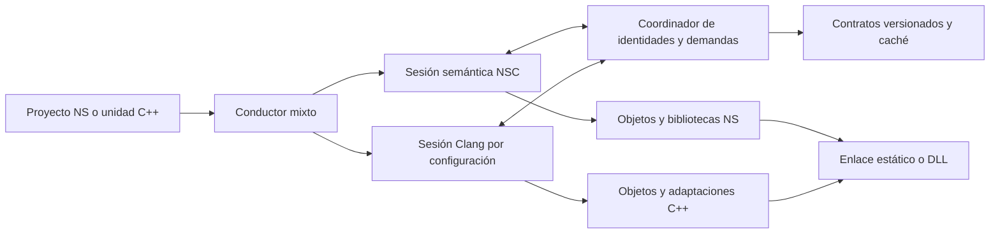

# Arquitectura propuesta de compilación mixta

Estado: **propuesta en investigación**. Los nombres de componentes y operaciones de este documento son conceptos de diseño, no APIs existentes. Las decisiones de representación y excepciones marcadas abiertas requieren contraste y, posteriormente, pruebas de implementación. Alcance: C/C++ ↔ NativeSharp, sin Daikon ni .NET en esta fase.

## Componentes y responsabilidades

1. El **conductor mixto** interpreta las entradas, conserva la configuración efectiva por unidad, crea las sesiones y ordena diagnósticos, dependencias y artefactos. Para C++ ordinario o NS ordinario debe conservarse el camino previo cuando la integración está desactivada.
2. La **sesión NSC** conserva los modelos semánticos y expone contratos y solicitudes de especialización. Es necesario decidir qué fases se pueden ejecutar incrementalmente y cómo conservar coherencia de índices; `ProjectCompilation.cpp:717` y `ProjectGenericModel.cpp:561` evidencian que el modelo actual no ofrece sin más un build incremental abierto.
3. La **sesión Clang** mantiene las declaraciones y tipos de una configuración de compilación, Sema, diagnósticos y, cuando corresponda, CodeGen. No debe combinar indiscriminadamente unidades con preprocesador u opciones incompatibles. El Clang propio instalado en A: contiene las bibliotecas y paquetes CMake que sirven como candidato para integrar esta sesión en NSC.
4. El **coordinador** mantiene la correspondencia entre las identidades de ambos frontends y resuelve demandas de forma determinista. El proveedor que se integra en el AST de Clang utiliza `ExternalASTSource`, siempre respetando las demás fuentes AST, PCH y módulos.
5. Los **contratos versionados** registran lo necesario para una compilación separada y caché sin serializar punteros de AST. No se presume que `.nsmeta` existente pueda representar C++ completo: su validador y su ruta de reconstrucción son contratos NS.

## Identidad y demanda: contrato conceptual

Una identidad de entidad debe distinguir lenguaje y módulo de origen, unidad o contexto de declaración canónica, entidad/plantilla, argumentos de tipo y de valor, target y configuración que afecte semántica o ABI. El diseño debe cubrir declarations redeclaradas, anónimos, tipos locales, especializaciones, `inline`, DLL, ODR y cambios de versiones. Los punteros a `Decl` o AST solo son válidos dentro de la sesión propietaria; para disco y comunicación entre sesiones se necesita una representación estable y validada.

**Formas concretas de argumentos.** Nuestro Clang `clang/include/clang/AST/TemplateBase.h:64-107` distingue tipos, declaraciones, punteros nulos, enteros, valores estructurales, templates, expansiones, expresiones y packs. NSC `GenericSpecializationRecord.h` registra `typeArguments` como cadenas y conserva además un `InstantiationContext`; `ConstGenericValue.h` representa un valor por kind, tipo y valor normalizado. Una interfaz mixta no debe reducir todas las formas Clang a nombres de tipo ni asumir que el registro NS cubre automáticamente `TemplateArgument`. En NS → C++, Clang puede conservar las formas propias del template C++ mientras el puente aporta los argumentos NS. En C++ → NS, se debe mapear cada argumento a un parámetro NS compatible, determinar qué extensiones de NS aportan capacidad real y registrar los casos sin correspondencia; no es obligatorio hacer que un genérico NS acepte formas C++ para las que no existe un contrato NS. El alcance de uso de bibliotecas C++ sigue completo y se analiza por separado de la ampliación eventual de genéricos NS.

El coordinador recibe una solicitud con identidad, operación deseada, ubicación y contexto. Registra dependencias y un estado pendiente/en proceso/completo/fallido, aplica límites y recuperación deterministas y devuelve la entidad resuelta con su contrato o un diagnóstico que preserve la causa. La API concreta y los estados finales se diseñarán al contrastar el código de ambos frontends.

NSC ya declara `Unseen`, `Queued`, `Building`, `Ready` y `Failed` en `Frontend/SpecializationState.h`; el comentario distingue los estados usados por la fase secuencial de los previstos para el planificador paralelo. `InstantiationContext.h` transporta proyecto, namespace, ubicación, packs y proyecciones. El coordinador debe estudiar la reutilización de esos conceptos en lugar de duplicarlos, sin suponer que la sesión actual permite reentrada desde Clang. Los parámetros genéricos NS distinguen tipo, constante y sus packs (`AST/GenericParameterSyntaxKind.h`), y los valores constantes distinguen entero, booleano, enum y estructural (`Language/ConstGenericKind.h`); cada forma exige un mapeo y validación, no solo comparación textual.

**Evaluación en tiempo de compilación:** Clang evalúa expresiones dependientes y constantes mediante sus propias rutas (`clang/lib/Sema/SemaTemplate.cpp:6593-6617`, `clang/lib/AST/ExprConstant.cpp`); NSC normaliza argumentos y usa su evaluador (`src/Frontend/Generics/Support/ConstGenericArguments.cpp:147-188`). La resolución de un template o `constexpr` C++ debe permanecer en Clang con sus reglas y contexto, en lugar de evaluar su texto como si fuera una expresión NS. Para valores que realmente crucen a un genérico NS se necesita una conversión tipada y comprobada, incluyendo ancho, signo, representación estructural, dependencia y diagnóstico; no todos los casos tienen correspondencia ya demostrada.

**Restricción importante:** `clang/lib/AST/DeclTemplate.cpp:391-401` busca localmente, consulta una fuente externa y busca otra vez antes de continuar. Una solicitud C++ → NS debe publicar una especialización Clang coherente antes de informar éxito. En Debug, `:404-421` puede volver a consultar durante la inserción: evitar doble publicación y espera de una demanda sobre sí misma. El diseño debe tratar recursión legítima, ciclos inválidos, rollback y diagnósticos, no solamente un conjunto que marque «visitado».

## Flujo A: código NS usa biblioteca C++

1. El proyecto declara la entrada C++ y sus opciones efectivas. El conductor obtiene una sesión Clang, analiza los headers o módulos y crea un dominio importado ligado a esa configuración.
2. Antes o durante las fases NS que lo necesiten, las consultas de tipos y miembros se resuelven mediante el dominio C++, preservando la visibilidad NS y los hechos semánticos C++. Las representaciones de origen y destino mantienen identidad y ubicación.
3. Al llamar una función o usar un template C++, la sesión Clang resuelve sobrecarga, conversiones e instanciación con los argumentos y categorías que corresponden al código NS. Un tipo NS utilizado como argumento se proyecta a Clang con su contrato, solicitando información adicional a NSC si hace falta.
4. NSC recibe un binding verificable: entidad elegida, tipo, conversiones, efectos, lifetime y contrato ABI. HIR/MIR lo conservan hasta CodeGen; no se reemplaza solo por el nombre.
5. El sistema emite una llamada directa si se ha establecido equivalencia física y semántica, o una adaptación generada que utilice el CodeGen C++ apropiado. El enlazador recibe todos los objetos y bibliotecas necesarios.

Punto de implementación candidato: `ProjectLoader`/`ProjectGraph` para entrada; `ProjectGenericModel` antes de nombres; `ProjectNameLookup` y `ProjectMethodBodyModel` para nombres y calls; HIR/MIR/LLVM para transporte y emisión. Debe concretarse el lugar de inyección sin alterar la precedencia de los programas NS existentes.

## Flujo B: código C++ usa biblioteca NS

1. El driver opt-in localiza y valida metadata y artefactos NS, o consulta una sesión NSC de código fuente. Crea un proveedor externo Clang sin desplazar el AST reader ni otras fuentes de módulos/PCH.
2. Al buscar `MyClass` o un miembro, el proveedor ofrece una declaración Clang asociada a la identidad NS. Completa estructura y operaciones cuando el frontend las requiere. La forma de `MyClass m` y `new MyClass` debe tener contrato explícito de construcción, identidad y destrucción.
3. Para una función o clase NS no genérica, el proveedor publica su declaración y conecta la operación y el símbolo correspondientes. Para un genérico NS solicitado desde C++, solicita además a NSC la especialización con argumentos mapeados y contexto. En ambos casos coordina las declaraciones, cualquier adaptación necesaria, emisión y enlace.
4. Clang usa sus propias reglas para el sitio de llamada C++; el puente enlaza con el cuerpo NS. Si el ABI no es equivalente, el sistema emite código de adaptación. Las tablas de despacho y RTTI NS y C++ no se presumen intercambiables.

Puntos candidatos: opciones en `clang/include/clang/Options/Options.td`, lectura de opciones de frontend en `clang/lib/Frontend/CompilerInvocation.cpp` e instalación coordinada con `CompilerInstance.cpp` y `FrontendAction.cpp`. El detalle del hook debe seguir el orden real del frontend. La construcción actual tiene plugins desactivados, por lo que no se basa inicialmente en una DLL plugin dinámica.

## Política de ABI, vida y errores

Las rutas de excepción y las alternativas de protocolo están desarrolladas en [DISEÑO-EXCEPCIONES-Y-VIDA.md](DISENO-EXCEPCIONES-Y-VIDA.md); siguen abiertas hasta contrastarlas con ambos compiladores y sus contratos.

- Para cada función, calcular o generar en su frontend el contrato físico real: calling convention, parámetros, retorno indirecto, `this`, conversiones, alineación y atributos. Una coincidencia de mangling o de tamaño no lo demuestra.
- Para cada tipo, registrar construcción, copia, movimiento, destrucción, representación de referencia, allocator, identidad y propiedad de cada módulo. El cruce de DLL con CRT estático y con copias del runtime NS se analiza explícitamente.
- Distinguir propagación a través de frames, captura tipada, adaptación, rethrow, `noexcept`, destrucción por unwind y excepción durante cleanup. NS usa filtro de código propio; Clang C++ en Windows usa representación/personality C++ distinta. Un puente que traduzca un tipo o cambie el comportamiento debe documentarse como tal y no considerarse automáticamente semánticamente idéntico.
- Para clases y `MyClass m`, decidir si la proyección C++ es un handle, un objeto de valor o una representación más profunda, y cómo se comportan copias, alias y `delete`. La decisión requiere mapear el contrato existente de NS, no inventarlo.
- Para clases, resolver explícitamente despacho y herencia, ajustes de receptor, RTTI y destrucción, incluyendo bases y DLL. Clang `MicrosoftCXXABI.cpp` describe variantes de destructor de ese target; Carbon incluye al menos una ruta documentada para Itanium que no debe extrapolarse a Windows.
- Inicialización de EXE/DLL, globales, TLS, arranque y terminación se prueban con ambos lenguajes como dueño de entrada, sin asumir que enlazar objetos ejecuta todos los inicializadores.

`WindowsRuntimeBuilder.cpp:6216-6247` documenta y genera un mecanismo que recupera el objeto NS del registro SEH y lo publica en TLS del módulo consumidor; el comentario describe DLL con estados TLS distintos. Es un punto concreto que debe conservarse y probarse al atravesar módulos mixtos. No prueba que excepciones C++ usen el mismo payload ni que todo el estado NS sea compartido o independiente en todas las configuraciones.

### Diseño de arranque mixto a contrastar

El código `WindowsRuntimeBuilder.cpp:276-309` crea `__nativesharp_start`, inicializa el mecanismo de excepciones NS, invoca `Main` y llama a `ExitProcess` al regresar. En ese cuerpo no aparece una llamada explícita al arranque del CRT ni al recorrido de inicializadores C++; esto es evidencia de la ruta examinada, no prueba de todo lo que pueda ejecutar otra capa de enlace o el cargador.

Para un EXE mixto, **propuesta inicial**: estudiar un punto de entrada de host generado que respete el arranque y la terminación requeridos por el CRT C++ y delegue la entrada de usuario a NSC, con inicialización NS explícita e idempotente; conservar el arranque NS actual para proyectos sin integración. En el sentido inverso, una biblioteca NS consumida por un EXE C++ debe exponer o recibir una vía documentada de inicialización y terminación según el runtime realmente necesario. DLL, `DllMain`, TLS y carga/descarga requieren ruta separada por el loader lock. No se debe invocar dos veces el arranque, saltar `atexit` ni presumir que basta llamar a `ExitProcess`.

Antes de seleccionar una implementación, construir el mapa de qué inicializa realmente cada runtime, qué tareas son por proceso/módulo/hilo y qué está disponible públicamente. La validación debe identificar el entry point real y observar constructores, destructores, TLS y terminación con instrumentación independiente del CRT; incluir controles de EXE NS + C++ estático/DLL y EXE C++ + NS estático/DLL. La propuesta no afirma todavía que un CRT concreto o una API de inicialización NS se puedan usar de esa forma sin cambios.

## Cuestiones que todavía impiden una decisión final

1. Seleccionar la frontera exacta de sesión/demanda de NSC y demostrar que los modelos e índices se pueden extender o reconstruir de forma correcta ante demandas recíprocas.
2. Identificar las operaciones NS que se deben exponer como clase C++ y si se necesitan varias proyecciones para respetar valor y referencia, herencia y ownership.
3. Determinar el protocolo de excepción/captura y la emisión correcta de cleanup en todos los escenarios; el análisis de caminos está iniciado, no terminado.
4. Precisar si las APIs existentes de Clang bastan o qué cambios en sus implementaciones internas requiere cada caso, en vez de declarar necesario modificar globalmente Clang.
5. Completar la matriz de lenguaje con reglas de origen y pruebas por contrato; resolver versión LLVM, compilación separada, COMDAT y dependencias de empaquetado.

## Callbacks y operaciones asíncronas entre lenguajes

**Hallazgos.** NSC baja `LambdaCreate` y acceso a capturas en `src/Frontend/MIR/Internal/MirNodeMachine.cpp:1205-1212`; `src/LLVM/Lowering/OopLlvmClosuresDelegatesEvents.cpp:661` crea el valor de lambda y `OopLlvmCalls.cpp:376` contiene una ruta de llamada a closure. Las suspensiones NS pasan por `MirNodeMachine.cpp:1640-1654` y `OopLlvmCoroutines.cpp:44-47`. En Clang, `clang/lib/CodeGen/CGCoroutine.cpp:225-287` genera la suspensión C++ y distingue las variantes de `await_suspend`; `:908` emite el cuerpo de la corutina. Estas rutas distintas no demuestran que los objetos, capturas ni frames sean intercambiables.

**Dirección de diseño para callbacks.** Tratar una lambda o función invocable C++ como su tipo y sus operaciones resueltas por Clang, incluido `operator()`, y conservar sus reglas de copia, movimiento y destrucción. En el sentido inverso, proyectar un objeto invocable NS al AST de Clang y generar automáticamente el cuerpo de llamada y las operaciones de vida que requiera el contrato; un puntero de función por sí solo no representa una captura. Para APIs C que aceptan función y contexto, evaluar un trampoline y contexto generado con vida explícita; para APIs que solo aceptan un puntero de función, no suponer que una captura puede guardarse o recuperarse sin restricciones. Definir qué lado conserva y libera el estado, concurrencia, unregister y comportamiento al lanzar. Una biblioteca C++ que recibe un template invocable debe poder instanciarse con la proyección NS, no depender de una lista de bibliotecas especiales.

**Puntos de implementación observados:** `OopLlvmClosuresDelegatesEvents.cpp:86-103` declara helpers de retención/liberación de celdas de captura y `:455,763` contiene las rutas de destrucción y creación de delegates. `OopLlvmCalls.cpp:376-393` recupera el receptor de una celda en una ruta de llamada a closure. En contraste, `OopLlvmThunksAndWrappers.cpp:666-670,732-733` describe el delegate `extern C` como puntero de función sin la representación normal de celda; su frontera actual de callback incorpora una guarda que puede terminar mediante `CallbackExceptionEscape` (`:101-134,331-402`). En Clang, `SemaLambda.cpp:2269-2285` forma campos e inicializadores de captura del tipo de cierre C++. Estos caminos no son una representación común ya demostrada.

**Cambios propuestos:** el binding de invocables debe transportar tipo de llamada, categoría, forma de captura, operaciones de copia/move/drop y política de escape; la emisión debe generar un objeto invocable C++ que invoque el delegate NS o una celda NS que invoque el objeto C++, según el contrato elegido. Reutilizar las operaciones de vida del productor y garantizar que los puntos de entrada sigan vivos mientras se retenga el callback. Extender semántica, HIR/MIR y lowering donde no puedan expresar esa identidad y transferencia. La guarda `extern C` existente debe mantenerse para su contrato, pero no debe aplicarse automáticamente a callbacks C++ que necesiten propagar excepciones: la frontera mixta requiere la política de excepciones diseñada para ella. La compatibilidad de un callback con una firma C sin contexto depende de las capacidades reales del callable y de la API, no se presume universal.

**Dirección de diseño para corutinas.** Separar usar desde NS un objeto C++ retornado por una función que internamente es corutina —tratándolo inicialmente conforme a su API C++— de permitir `await` entre modelos asíncronos. Para este último se necesita mapear explícitamente preparación, suspensión, continuación/reanudación, resultado/error, destrucción del frame y ownership, garantizando una única liberación y vida de capturas. En la dirección inversa, proyectar el contrato invocable/awaitable NS que corresponda y dejar que Clang aplique sus reglas C++. No reinterpretar un frame o handle de un lenguaje como si fuera el del otro solo porque ambos usen LLVM. Qué formas se pueden conectar sin extender la semántica de NS sigue pendiente de diseño y verificación.

**Evidencia adicional de protocolos:** `src/Frontend/MIR/MirFunctionLowerer.cpp:503-527,574-590` calcula espacio para locales y slots de futures; `src/LLVM/Lowering/OopLlvmCoroutines.cpp:117-146,961-1008` gestiona un frame NS y el hijo de un `await`. Clang `clang/lib/Sema/SemaCoroutine.cpp:348-355,382-444` construye llamadas `await_ready`, `await_suspend` y `await_resume`; `:742-747` prepara suspensiones inicial y final y verifica el contrato de esta última; `:1769-1794` trata `unhandled_exception`. Una adaptación propuesta debe conectar el protocolo de avance/poll NS con el awaiter y la continuación C++ sin asumir que todos los futures aceptan el mismo mecanismo de notificación o que todos los `await_suspend` se comportan igual. Debe cubrir reentrada y carrera entre completar y registrar la continuación, así como cancelación y liberación del frame; el código citado identifica dónde investigar, no demuestra que exista ya un ejecutor compartido ni qué política de hilos debe elegirse.

Validación propuesta en ambos sentidos: captura por valor y referencia, callback síncrono y retenido después del retorno, copia/movimiento y destrucción, callback durante destrucción, excepciones, cruce de DLL y concurrencia; corutinas con resultado, error, suspensión real, reanudación, cancelación/destrucción temprana, temporales vivos y cierre de módulo. Estas pruebas verifican los contratos seleccionados, no cierran por sí solas toda la semántica C++.

## Herencia y despacho entre C++ y NativeSharp

El layout de C++ debe venir de Clang para la configuración efectiva. `clang/lib/AST/RecordLayoutBuilder.cpp:2464-2475` documenta, en la sección de layout Microsoft, bases, punteros de tablas virtuales, bases virtuales y `vtordisp`; `clang/lib/CodeGen/MicrosoftCXXABI.cpp:1797-1803` consulta las posiciones de vfptr al emitir tablas. NSC conserva slots de despacho e interfaz en `include/nativesharp/Frontend/ProjectOopMirNode.h:69-70` y una clase NS tiene su descriptor propio. Estos datos no establecen una correspondencia automática de objetos o tablas.

**Consecuencia para una clase que participa en ambas jerarquías:** `ProjectOopMirDispatchTable.h:27-53` modela una base NS, slots, tablas de interfaz y dos entradas de destrucción; también distingue datos importados, que pertenecen al productor. El mismo archivo documenta la secuencia de destrucción de la clase derivada a las bases y la delegación a una base precompilada. En Clang, `MicrosoftCXXABI.cpp:2278-2316` muestra ajustes de `this` que pueden depender de `vtordisp` y tablas de bases virtuales. No se puede sustituir el ajuste de C++ por un índice de slot NS ni asumir que el puntero a cada subobjeto tiene el mismo valor.

Carbon ofrece un precedente acotado: `toolchain/check/cpp/export.cpp:1423-1429` documenta una ruta donde la entrada virtual C++ es un thunk y el overrider Carbon no se publica directamente como virtual. Para nuestro diseño, investigar la emisión de puentes de despacho y ajuste guiados por Clang y las tablas NS del productor; registrar también quién construye y destruye cada subobjeto y el orden exacto. Esto es una alternativa de implementación, no evidencia de que Carbon o ese único patrón resuelvan toda herencia múltiple, RTTI o destrucción cruzada en nuestro target.

Para **consumir una jerarquía C++ desde NS**, proyectar los tipos y conversiones de base derivadas del AST de Clang; para acceder o llamar un virtual, usar la operación y el ajuste de receptor que Clang resuelva para esa jerarquía. Para **exponer una jerarquía NS a C++**, definir una representación visible y el despacho hacia NS, conservando su identidad y destrucción. Si se desea derivación y override **entre** lenguajes, se necesita además un diseño explícito de layout del objeto combinado, rutas de despacho en ambas direcciones, RTTI/casts, construcción y destrucción de bases, accesibilidad y ajuste de receptor. No basta emitir una declaración `class` con nombres coincidentes. Puede requerir ampliar NSC, generar operaciones específicas con Clang o modificar el fork cuando sus interfaces no basten; decidirlo exige examinar cada combinación, no se presume resuelto.

Validar jerarquías simples y múltiples, bases virtuales, conversiones ambiguas, override y llamadas de base, objetos creados y destruidos desde cada lado, fallos durante construcción, RTTI/casts, DLL y callbacks en destructores. Estos ejemplos identifican contratos, no limitan el alcance a ellos.

## Propiedad y finalización del código generado

**Carbon observado:** `toolchain/check/cpp/generate_ast.cpp:873-894` crea generadores Clang para las entradas que se van a bajar y los agrupa en un `MultiplexConsumer`; `cpp/thunk.cpp:676-681` y `cpp/export.cpp:1737-1742` entregan declaraciones de adaptadores al consumidor AST. `toolchain/lower/file_context.cpp:194-200` termina la unidad Clang con `HandleTranslationUnit` y `lower/context.cpp:93-99` libera la propiedad del módulo con `ReleaseModule`. El propio código Carbon deja pendiente filtrar definiciones fuertes por generador, por lo que no se debe reproducir su estrategia como si resolviera la emisión única en todos los casos.

**NSC observado:** `src/LLVM/Internal/OopLlvmImplementation.cpp:120-133` crea su propio contexto y módulo LLVM; `:170-180` finaliza el constructor de debug y verifica el módulo; `:204-208,230-249` muestran la cesión del módulo y limpieza de recursos. `src/Driver/DriverArtifactGeneration.cpp:52-79` solicita el paquete de objetos y completa la etapa de generación; `:269-270,917-920` entrega objetos al productor del EXE o DLL. Estos puntos son la ruta observada, no una demostración de que hoy se puedan introducir objetos de Clang en todas las combinaciones.

**Dirección propuesta:** el coordinador asigna propietario y unidad de emisión a cada especialización/adaptador, mantiene vivos el AST y CodeGen de Clang hasta emitir y finalizar sus declaraciones, y obtiene un módulo u objeto válido; NSC mantiene su propio módulo y lifecycle. La primera opción de integración a evaluar es enlazar objetos compatibles generados por cada productor, conservando símbolos, COMDAT, excepciones y CodeView; para LTO se estudia por separado la interoperación de bitcode de revisiones/configuraciones compatibles. Una fusión de módulos LLVM es alternativa, no obligación, y requiere gestionar contextos, layouts, ownership y metadatos explícitamente: no se deben intercambiar `Value*` o tipos entre contextos LLVM distintos ni asumir que un módulo puede destruirse mientras otro conserva referencias a su contexto. En todos los casos, finalizar y verificar cada unidad con su productor, asociar ubicaciones fuente NS/C++ y preservar entradas de debug necesarias. La elección y el orden deben validarse para compilación separada, ejecución y depuración; no se ha probado aún esta integración.

## Frontera interna propuesta entre compiladores

Esta es una interfaz de diseño, no un API existente. Debe vivir en un componente de interoperabilidad de NSC enlazado con Clang y tener propiedad explícita de sus sesiones:

| Operación | Entrada | Resultado y responsabilidad |
|---|---|---|
| Abrir unidad C++ | target, idioma, headers, defines, includes y flags normalizados | Sesión Clang viva, diagnósticos y conjunto de dependencias; no compartir sin control los AST de configuraciones distintas. |
| Consultar declaración | ámbito, nombre e identidad del proyecto | Identidad estable dentro de la sesión y descripción de tipo; conservar la declaración Clang de origen para la semántica posterior. |
| Resolver operación C++ | declaración, receptor y argumentos con tipos, categorías y cualificadores | Operación seleccionada por Sema, conversiones y restricciones de acceso; registrar materialización, temporales y efectos. El punto exacto donde construir expresiones Clang y convertir argumentos NS requiere prototipo. |
| Solicitar instancia | plantilla o genérico, argumentos tipados/de valor, contexto y configuración | Instancia canónica o error; si Clang realiza una consulta síncrona, registrar en su AST la especialización antes de responder éxito. Gestionar recursión y estados incompletos sin publicar una definición fallida. |
| Consultar contrato de representación | tipo y target | Tamaño/alineación, campos y bases cuando corresponda, representación de referencia o valor, operaciones de vida y origen de la autoridad de ABI. Los datos no reemplazan los métodos del frontend responsable. |
| Preparar emisión | operación resuelta, ownership, excepciones y ubicación | Llamada o adaptación generada por el frontend responsable, símbolo/enlace y dependencias, con cleanup explícito. Mantener por separado el orden de evaluación de argumentos del orden físico del ABI. |
| Sellar unidad | instancias y declaraciones utilizadas | Completar emisión y diagnósticos mientras los contextos siguen vivos, publicar artefactos/metadata y luego liberar sesiones. Versionar entradas persistidas; nunca serializar punteros AST. |

El proveedor inverso expone a Clang declaraciones y definiciones NS bajo demanda; `ExternalASTSource` y el patrón observado en Carbon son la primera vía a evaluar. La interfaz debe distinguir **identidad semántica**, **representación física**, **nombre de enlace** y **ownership**: coincidir en cualquiera de ellos no demuestra los demás. Clang puede diagnosticar semántica C++ y NSC semántica NS con ubicación de origen y contexto de la cadena de instanciación; el conductor debe conservar ambos, sin ocultar el error original.

En concreto, el conductor NS actual elige una fase en `src/Driver/DriverProjectActions.cpp:97-114` y el camino de compilación recupera o construye MIR en `:520-525`. La sesión mixta debe quedar disponible antes de las fases que necesiten declaraciones extranjeras y participar también en la invalidación de una restauración; no debe añadirse solamente al paso final de enlace. Carbon implementa un `clang::DiagnosticConsumer` en `toolchain/check/cpp/diagnostic_consumer.cpp:343-351` y agrupa las notas que Clang emite separadamente; eso sirve de precedente para conservar error principal, notas y contexto, sin asumir que sus diagnósticos o fix-its sean directamente compatibles con NSC.

La restauración merece un control específico: `DriverProjectActions.cpp:514-521` llama a `restoreCompilationBundle` y retorna antes de construir MIR si la restauración tiene éxito; en `:666-669` una ruta también retorna el resultado restaurado. Por tanto, agregar dependencias C++ solo a la caché MIR sería insuficiente si la búsqueda del bundle no las contempla. Hay que incluir identidad/configuración de Clang, opciones y cierre transitivo de archivos en la clave del manifiesto anterior a esa búsqueda, o desactivar la restauración mixta hasta hacerlo. El mecanismo concreto de descubrimiento de dependencias y su invalidación todavía debe elegirse; una compilación NS sin C++ debe mantener su comportamiento.

No se decide todavía que esta frontera sea una API pública estable, un proceso separado o que requiera cambios al núcleo de Clang. Primero se usan las interfaces existentes; una modificación del fork se justifica cuando falte una capacidad necesaria y se documenta su superficie exacta, para no mantener un parche especulativo.

## Evaluación en compilación y metaprogramación cruzada

**Evidencia:** Carbon `toolchain/check/cpp/constant.h` declara conversiones entre `clang::APValue` y constantes Carbon, y evaluación de variables y llamadas C++ `constexpr`/`consteval`. En `constant.cpp:166-195` convierte valores enteros, booleanos y flotantes hacia `APValue`, con un TODO explícito para más tipos; en `:223-293` intenta evaluar una llamada mediante `EvaluateAsConstantExpr` y distingue el error requerido por `consteval` de una llamada que no resulta constante. En nuestro Clang, `clang/include/clang/AST/Expr.h:769-774` declara `EvaluateAsConstantExpr`. NSC tiene rutas propias: `src/Frontend/Generics/Support/ConstGenericArguments.h` decodifica y normaliza argumentos constantes y `src/Frontend/MIR/MirConstantEvaluator.h` declara evaluaciones de entero, flotante, bool y string. Estas funciones tienen contextos y capacidades concretas; sus nombres no demuestran un evaluador C++ completo en NSC.

**Dirección C++ → NS:** conservar la expresión y declaración C++ en la sesión Clang y delegar a Clang las reglas `constexpr`/`consteval` y de templates. Cuando NS necesite el resultado como constante o argumento genérico, convertir desde una representación tipada como `APValue` a una representación NS canónica, conservando tipo, ancho, signo, identidad y estructura cuando corresponda. Registrar si el resultado es constante, no constante, dependiente o erróneo; `consteval` no puede degradarse silenciosamente a llamada en ejecución. Los valores no representables todavía necesitan diseño y trabajo adicional, no deben reinterpretarse como bytes arbitrarios.

**Dirección NS → C++:** mapear las constantes NS y sus tipos a valores que Clang acepte para la posición C++ concreta y comprobar constraints allí. Si C++ necesita evaluar durante compilación el **cuerpo** de una función NS, disponer del símbolo binario o de su `sourceText` no equivale a tener una definición que el evaluador de Clang pueda ejecutar. Se necesita diseñar una representación evaluable, una interfaz entre evaluadores o una extensión verificable de frontend/evaluador, con reglas de efectos y diagnóstico acordes al contexto. La equivalencia de todos los dominios de constantes y de todos los cuerpos no está demostrada; esta brecha permanece en alcance, no se cierra con un diagnóstico ni con una llamada ejecutada en runtime.

**Validación prevista:** valores con ancho y signo dependientes del target, bool y enums, flotantes, referencias y direcciones permitidas, agregados estructurales, packs, expresiones dependientes, selección de overloads/constraints y errores; probar llamadas cruzadas constantes y no constantes en ambos sentidos. El código Carbon orienta el diseño y contiene sus propios límites; no se copia como lista completa de casos.

### Representación concreta de argumentos constantes

En el NSC observado, `include/nativesharp/Language/ConstGenericValue.h` contiene `kind`, `typeKey` y `normalizedValue` textual; `ConstGenericKind.h` enumera entero, booleano, enumeración y estructural. La función `src/Frontend/Generics/Support/ConstGenericArguments.cpp:147-195` normaliza recursivamente una expresión de tupla mediante componentes y marcadores con longitud, o normaliza bool y expresiones admitidas por `ProjectIntegerEvaluator`. Esa ruta concreta no demuestra por sí sola cobertura de todos los valores estructurales de C++.

Clang, en `clang/include/clang/AST/TemplateBase.h:64-107`, distingue tipo, declaración, puntero nulo, integral `APSInt`, valor estructural `APValue`, template, expansión, expresión dependiente y pack; el integral conserva ancho y signo (`:121-139`). Un resultado estructural C++ no se debe convertir a una tupla NS solo porque ambos se llamen estructurales: pueden diferir identidad nominal, miembros, bases, restricciones de equivalencia y semántica de valor. Tampoco se debe usar el texto de un puntero como identidad de una declaración.

**Cambio propuesto:** introducir en la frontera una representación etiquetada y tipada que retenga la clase original, tipo nominal o de parámetro, ancho/signo o valor estructurado según corresponda, identidad de declaración/template y componentes de packs. Mantener la expresión dependiente asociada al AST de Clang hasta que el frontend responsable la resuelva. Convertir al marcador NS únicamente después de comprobar que el dominio y la equivalencia son válidos en el destino; si es necesario persistir valores nuevos, versionar su codificación e identidad, preservando los formatos actuales. La implementación de `ConstGenericValue` y los índices/cachés que consumen `normalizedValue` son candidatos a extender o envolver, no se ha comprobado que tengan que modificarse todos.

Carbon ilustra por qué hay que detallar el contrato: `constant.cpp:20-65` registra TODO para rutas lvalue sin path, one-past-end, arreglos y subobjetos base; `:92-129` maneja ciertos lvalues, enteros y flotantes y deja otros valores pendientes; `:166-195` convierte hacia Clang enteros, bool y flotantes, con TODO para tipos adicionales; `:262` anota que una llamada de miembro no está representada correctamente en esa ruta de evaluación. Estos son límites de ese código y revisión, no exclusiones aprobadas para NativeSharp.

### Identidad y caché de especializaciones NS con argumentos C++

**Evidencia NSC:** `src/Frontend/Generics/TemplateResolver.cpp:357-378` forma la clave de instancia con la clave canónica de plantilla y las identidades de sus argumentos. `TypeSpellingAndVisibility.cpp:179-218` usa una identidad ya resuelta cuando existe; para un nombre todavía no resuelto conserva spelling y origen de módulo/namespace, con longitudes, para distinguir orígenes NS. `SpecializationExecutor.cpp:497-527,554-566` consulta el planner, intenta restaurar y, si materializa, reserva y revierte el estado al fallar. El modelo ya tiene mecanismos de identidad y rollback; no se ha demostrado una colisión en las entradas que actualmente admite.

**Distinción de cachés:** `Generics/Cache/TemplateCatalogCodec.cpp:27-49,94-102` obtiene una huella de tokens fuente y la combina con la versión del esquema para una caché C1 de plantilla; `GenericTemplateRecord.h:63-67` describe esa finalidad. Esa clave de sintaxis no debe confundirse con una prueba de que la instancia semántica o el código generado sean independientes de argumentos C++, flags o headers. Según lo que cada capa almacene, puede conservarse una caché de sintaxis cuando sus entradas sean suficientes y añadir identidad/dependencias a las capas que materializan o generan código; no hay base para invalidar indiscriminadamente toda la caché NS ni para reutilizar ciegamente una especialización mixta.

**Cambio propuesto:** adaptar el origen de `typeSpecializationIdentity` o introducir una identidad extranjera equivalente que represente la declaración C++ canónica, su especialización y contexto semántico sin depender de spelling o punteros efímeros. Incorporar a las claves de resultados dependientes la revisión efectiva de Clang/NSC, target, opciones, entradas C++ y contratos físicos/semánticos necesarios. Conservar la correspondencia con nombres publicados por metadata NS (`SpecializationExecutor.cpp:573-595`), con versionado si cambia el contrato. La forma de reconciliar identidades entre dos unidades Clang y las reglas ODR C++ requiere diseño y validación; ni el origen NS existente ni una ruta de header son prueba suficiente de equivalencia. Verificar deduplicación y rollback cuando una solicitud cruzada sea recursiva o falle, sin convertir la observación de código en garantía de reentrada segura.
